# Physically Modelled Concert Grand for iPad Pro M2 — Engineering Plan

Target timbre: Steinway Model D. Platform: iPadOS 27, iPad Pro M2. No samples. Quality reference: Modartt Pianoteq 9 (as a listening and feature benchmark only).

**Conventions used in this document**

- **[ASSUMPTION]** — a choice I made because the brief did not fix it.
- **[VERIFY]** — a fact I could not confirm; it has a named verification step in the roadmap.
- **[ESTIMATE]** — a number derived by reasoning, not measured. All CPU figures are estimates until milestone M1 benchmarks them on the device.
- Numeric string/hammer data are *starting values* for calibration, not measured Steinway D data.

---

## 0. Executive summary

**What we build.** A SwiftUI app plus AUv3 instrument whose sound comes entirely from a portable C++20 engine. The engine models all ~240 strings of the piano permanently (they are never "voices" that start and stop), a nonlinear hammer per key, a modal soundboard coupled to the strings through the bridge, radiation to virtual microphones, and a synthetic room.

**Core technical decision: coupled-mode (modal) string synthesis, not waveguides.** Each string partial is a damped complex resonator. The three strings of a unison, in two polarizations, coupled through the bridge, are diagonalized offline into normal modes, so double decay and beating are exact by construction. Reasons:

1. Inharmonicity and per-partial decay are set exactly per mode; a waveguide needs high-order dispersion allpass filters that are hardest to design exactly where the piano is most critical (bass).
2. Re-striking a sounding string, half-pedalling and voicing changes are artefact-free: the state of a mode is a phasor, and coefficients can change under it.
3. Sympathetic resonance is free: all strings always exist, and the bridge signal drives them all.
4. The inner loop is a flat array of identical resonators — ideal for NEON and predictable for real-time.
5. Memory is under 5 MB, which makes the AUv3 trivial to ship.

The cost is CPU: roughly 26,000 resonators in the worst case, estimated at 20–35 % of one M2 performance core when every mode is active **[ESTIMATE]**, and typically 3–10 % with energy-based culling. Milestone M1 exists to prove or kill this number before anything else is built on it. The fallback is a waveguide for the upper partials or a multirate modal bank.

**A second, offline model is part of the plan.** A finite-difference stiff-string solver with hammer (Chaigne–Askenfelt style, desktop only, Python/C++) serves as ground truth for validating the real-time model and for experiments. It never ships.

**Voicing is half the project.** Physics gives a piano; calibration gives a Steinway D. The plan includes a Python analysis toolchain (partial tracking, inharmonicity fits, per-partial T60, attack metrics), a parameter-fitting loop, and blind listening tests against reference recordings and Pianoteq 9 renders of the same MIDI files.

**MIDI is a first-class subsystem.** Core MIDI input with host-time stamps goes through a lock-free queue and is scheduled sample-accurately. Basic notes, velocity and sustain are in the first playable milestone. The Komplete Kontrol M32 is the reference device, with one important limitation stated up front: on iPad the M32 runs only in its generic MIDI mode with the factory template. NKS integration, the display, and custom templates are not available, and its octave buttons do not report their state. The design works around all of these (§3.2).

**Latency target, restated.** An instrument has no audio input, so "round-trip" is not the right measure. The target is **key-to-sound ≤ 8 ms over USB with wired or built-in output** (64–128 frame buffer at 48 kHz, engine adds zero look-ahead). Bluetooth LE MIDI adds 7.5–15 ms or more per event and cannot meet this; Bluetooth audio output adds over 100 ms and gets an on-screen warning.

**Schedule.** About 51 person-weeks for one experienced developer **[ASSUMPTION: one full-time developer]**. MVP (playable, coupled unisons, soundboard, pedals, basic MIDI, standalone app) at about week 24.

### Signal flow

```mermaid
flowchart LR
  subgraph Controllers
    M32[Komplete Kontrol M32<br/>USB-C class compliant]
    BLE[BLE MIDI device]
    NET[Network MIDI]
    TOUCH[On-screen keyboard]
    SMF[MIDI file player]
  end

  subgraph MIDI_thread[Core MIDI thread / main thread]
    CM[Core MIDI input port<br/>UMP MIDIEventList + host timestamps]
    PROF[Device profile:<br/>channel filter, transpose,<br/>velocity curve, CC mapping, takeover]
  end

  Q[[Lock-free SPSC event queue<br/>host-time stamped]]

  subgraph Audio_thread[Audio render thread - C++ core]
    SCHED[Event scheduler<br/>host time to sample offset]
    HAM[Hammer per key<br/>nonlinear felt, scalar Newton]
    DAMP[Damper and pedal state<br/>per-mode loss modulation]
    STR[String modal bank<br/>~240 strings, coupled unisons,<br/>2 polarizations]
    LONG[Longitudinal modes,<br/>duplex segments]
    BR((Bridge))
    SB[Soundboard modal bank<br/>300-600 modes]
    NOISE[Action, damper, pedal noise models]
    RAD[Radiation: lid, rim,<br/>per-mic modal gains and delays]
    ROOM[Room: early reflections + FDN<br/>or synthetic-IR convolution]
    OUT[Stereo or binaural out]
  end

  M32 --> CM
  BLE --> CM
  NET --> CM
  CM --> PROF --> Q
  TOUCH --> Q
  SMF --> Q
  Q --> SCHED
  SCHED --> HAM
  SCHED --> DAMP
  HAM -- contact force --> STR
  STR -- string displacement at strike point --> HAM
  DAMP --> STR
  STR -- bridge force --> BR
  LONG --> BR
  STR --> LONG
  BR --> SB
  SB -- bridge velocity: sympathetic drive --> STR
  NOISE --> SB
  SB --> RAD --> ROOM --> OUT
  SCHED -. recorded events .-> REC[Performance recorder<br/>SMF export, MIDI thru]
```



---

## 1. Physics and model architecture

### 1.1 String model: comparison and choice

| Criterion | Digital waveguide + dispersion/loss filters | Modal (chosen) | FDTD (offline reference) |
|---|---|---|---|
| Inharmonicity accuracy | Limited by allpass design; bass needs order 8–20+ | Exact per partial | Exact up to numerical dispersion; needs oversampling |
| Per-partial decay | One loss filter, fit is approximate | Exact per partial | From PDE loss terms, 2 parameters |
| Unison coupling, double decay | Needs coupled loops, careful tuning | Diagonalized offline, exact | Natural but expensive |
| Hammer interaction | Natural (scattering junction) | Scalar nonlinear solve at strike point | Natural |
| Re-strike, parameter change | Delay-line length changes click | Artefact-free | n/a |
| Cost per string | Very low (~30–60 ops/sample) | Proportional to partial count | 10–100× real time budget |
| SIMD friendliness | Poor (many small heterogeneous filters) | Excellent | Good |
| Sympathetic resonance of all strings | Cheap | Costly but uniform; culling helps | Not feasible in real time |

**Decision.** Real-time engine: modal. Offline reference: FDTD. A waveguide is kept only as a fallback for partials above about 5 kHz if M1 benchmarks miss the budget.

### 1.2 Stiff string physics

Transverse displacement y(x,t) of a stiff, lossy string (Chaigne–Askenfelt / Bensa form):

```
μ ∂²y/∂t² = T ∂²y/∂x² − E·S·κ² ∂⁴y/∂x⁴ − 2·b1·μ ∂y/∂t + 2·b3·μ ∂³y/∂t³ + f_hammer(x,t)
```

with μ linear density, T tension, E Young's modulus, S core cross-section, κ = d/4 radius of gyration.

Per-partial quantities, pinned ends:

```
f_n = n·f0·sqrt(1 + B·n²)            B = π³·E·d⁴ / (64·T·L²)
σ_n = b1 + b3·(2π f_n)²              T60_n = 6.91 / σ_n
φ_n(x) = sin(nπx/L)                  modal mass m_n = μL/2
```

The loss term is the Chaigne–Askenfelt third-time-derivative form, which gives the σ_n above with b3 in seconds. (Bensa's mixed-derivative form ∂³y/∂t∂x² is better posed for finite-difference schemes but gives σ = b1 + b3·k² with b3 in m²/s; the offline reference must pick one and convert.) Note that f0 here is the flexible-string fundamental: the first partial sounds at f0·sqrt(1 + B), so tuning targets must be applied to the sounding partial.

The two-parameter loss law is only a first fit. The real decay of a partial is dominated by the bridge admittance at that frequency, which the coupled model supplies separately (§1.4), so b1 and b3 represent internal and air losses only.

**Wound bass strings.** The copper winding adds mass but almost no stiffness: use μ of core plus winding, and E·S·κ² of the core only (a small correction factor for the winding is a voicing parameter). The unwound end sections make the string non-uniform, so its partials deviate from the single-B law. The model stores f_n per partial rather than (f0, B), so fitted deviations go straight into the table.

**Two polarizations.** Vertical (hammer direction) and horizontal modes are separate resonators with slightly different frequencies and very different bridge coupling. The bridge is much stiffer horizontally, which yields the slow second decay stage.

**Longitudinal modes and phantom partials.** Transverse motion modulates tension; the resulting longitudinal force is quadratic in transverse slope (Bank and Sujbert). Consequences: phantom partials at f_m + f_n and 2·f_n, and a longitudinal "ring" at the first longitudinal mode, roughly 12–20 times f0 in the bass. Implementation:

- For keys 1 to about 40 only.
- Excitation: for the lowest K_L ≈ 20 transverse modes, form the products that satisfy the selection rule (m + n odd couples to odd longitudinal modes, and so on), computed at a decimated rate with band-limiting.
- Response: 2–4 longitudinal resonators per string, plus the non-resonant (forced) component added directly to bridge force.
- Level and longitudinal frequency per key are voicing parameters. Piano makers tune this mode deliberately, so it matters to the bass character.

### 1.3 Unisons: detuning, coupling, double decay, beating

For one key, take partial n of each of its S strings (S = 1, 2 or 3) in two polarizations: 2S oscillators that share the bridge. Following Weinreich, with bridge admittance matrix **Y**(ω) (2×2, vertical/horizontal) evaluated at ω_n:

```
dq/dt = (jΩ − Γ − C) q        Ω = diag(ω_n,s,p)     Γ = diag(internal loss)
C = (coupling through bridge) ∝ Z0_s · ω-dependent gain · Y(ω_n), complex
```

The eigen-decomposition of this (2S × 2S) complex matrix gives 2S normal modes per partial, each with its own complex frequency (pitch and decay) and eigenvectors. This is done on a background thread whenever voicing or tuning changes, not in the audio thread. At run time each normal mode is one complex resonator with:

- an excitation weight: the projection of "hammer hits strings 1..S vertically" on the left eigenvector;
- a bridge-force output weight: from the right eigenvector.

Result: prompt sound and aftersound, beating between mistuned strings, and the effect of the una corda (changed excitation projection, same normal modes) all come out without run-time coupling logic. Unison detuning is a per-string cents offset (typical 0–1.5 cents, random with a seed, user-adjustable as "unison width").

For partials above roughly the 20th, the six normal modes are perceptually redundant; the engine keeps the 2–3 with the highest excitation × output weight. This is the main lever on mode count.

### 1.4 Hammer

State: hammer position x_h and velocity v_h; felt compression ξ = x_h − y_s(x_strike).

Force law — two selectable models:

```
Hunt–Crossley (default, cheap):   F = K·ξ^p·(1 + μ_h·dξ/dt)           for ξ > 0
Stulov (hysteretic, reference):   F = F0·[ ξ^p − (ε/τ0)·∫ ξ^p(t')·e^{−(t−t')/τ0} dt' ]
```

Typical ranges: p from 2.2 (bass) to 3.5 (treble), K from 10⁸ to 10¹² N/m^p. The dependence of brightness on velocity is not an added "velocity-dependent stiffness" parameter; it follows from the power law, since effective stiffness dF/dξ grows with compression. Voicing "hardness" scales K and p; separate piano/mezzo/forte hardness controls (as in Pianoteq) are implemented as a mild dependence of K and p on impact velocity.

Further details that are modelled:

- **Strike position** x_strike/L per key, about 0.12 in the bass and mid range, falling to about 0.06 in the top octave. It sets the comb in the spectrum.
- **Multiple contacts.** In the bass the reflected pulse returns while the hammer is still on the string; the hammer loop simply keeps running until ξ ≤ 0 for longer than the round-trip time.
- **Multiple strings per hammer.** One hammer mass, S contact points with small per-string offsets (hammer–string mating, a voicing parameter). Una corda shifts the offsets so one string is missed or grazed and the felt parameters move to the softer, less compacted region.
- **Shank flexibility** is neglected in v1 **[ASSUMPTION]**; it is a candidate for the "later" list.
- **Velocity mapping.** MIDI velocity maps to hammer velocity, about 0.3 m/s (ppp) to 5.5 m/s (fff) **[ESTIMATE, from Askenfelt and Jansson measurements]**, via the per-device curve (§3.4).

Numerics. The string's displacement at the strike point is linear in the current force sample:

```
y_s[n] = y_free[n] + g·F[n]      g = Σ_k w_k²·(instantaneous gain of resonator k)
```

so each sample of contact requires one scalar Newton solve, not a system solve. The hammer runs at 2× the audio rate during contact only (top-octave contact lasts about 0.5 ms, 24 samples at 48 kHz).

```cpp
// One hammer step during contact. dt = 1 / (2 * fs).
struct Hammer {
  float x, v;        // position, velocity (m, m/s)
  float invMass;     // 1/kg
  float K, p, mu;    // felt parameters
  float prevXi;      // compression at previous step
};

inline float hammerStep(Hammer& h, float yFree, float g, float dt) noexcept {
  // Predict hammer position without contact force.
  const float xPred = h.x + dt * h.v;
  const float a = dt * dt * h.invMass;            // effect of F on hammer position
  // Solve r(F) = F - K * xi^p * (1 + mu * (xi - prevXi)/dt) = 0,
  // with xi(F) = xPred - a*F - (yFree + g*F).
  float F = 0.0f;
  for (int it = 0; it < 4; ++it) {
    const float xi = xPred - a * F - (yFree + g * F);
    if (xi <= 0.0f) { F = 0.0f; break; }
    const float rate = (xi - h.prevXi) / dt;
    const float xp  = fastPow(xi, h.p);           // table or exp/log, branch-free
    const float f   = h.K * xp * (1.0f + h.mu * rate);
    const float dxi = -(a + g);
    const float df  = h.K * (h.p * xp / xi * (1.0f + h.mu * rate) + xp * h.mu / dt) * dxi;
    const float r   = F - f;
    F -= r / (1.0f - df);                          // Newton update
    F = std::max(F, 0.0f);
  }
  h.v -= dt * h.invMass * F;
  h.x += dt * h.v;
  h.prevXi = std::max(0.0f, h.x - (yFree + g * F));
  return F;                                        // applied to the string modes
}
```

**Implementation note (M2).** The sketch below is superseded. With the impulse-invariant resonator of §1.5 the instantaneous gain g of the sketch is exactly zero, so the implemented scheme (`core/pm_hammer`) differs: while in contact the hammer owns its key's modes and advances them in substeps with the force held constant per substep (exact zero-order-hold integration, which gives g > 0), the felt force is a discrete gradient of the felt potential solved by a safeguarded Newton iteration, and the static compliance of the partials above the kept band is added in series with the felt. The scheme conserves energy exactly for lossless felt and string. Substep factor: 1 below key 40, 2 for keys 40–75, 4 above.

*Evaluation (as built).* For R ≤ 4 (the table's substep factors) the solver makes one pass over the key's modes per base sample instead of one per substep: everything a sample's R substeps need is linear in the state at the sample start and in that sample's forces, y_s(r) = Im(P_sr z) + Σ_t Σ_{q≤r} h_st[r−q] F_t(q) with P_sr = proj_s C^(r+1) and h_st[d] = Σ_j Im(proj_sj C_j^d b_tj), and the state update z' = C^R z + Σ B_tq F_t(q) + wIn u with B_tq = C^(R−1−q) b_t. The pass reads one interleaved record per block of SIMD-width modes (B, wIn, P, C^R, wOut) and the state, adds the previous sample's pending forces, projects, rotates and sums the output; the R contact solves then run on scalars with the short convolution h. Same scheme as the per-substep evaluation (kept for other R and checked against it in the tests to −100 dB). The Newton predictor adds to the quadratic extrapolation of the felt compression the part of the free compression its own extrapolation misses, times de/d(free compression) of the last solve; the solve tolerance is 1e-8 of the compression (force error below the float rounding with which it enters the state). Once the hammer has left and provably cannot reach the strings again (moving away, beyond twice the bound Σ|proj||w| of every string's displacement plus 1 µm), it is released at its next release-grid point instead of after the 1.5-round-trip wait; until then only the modes run.

A unit test checks energy balance (hammer kinetic energy lost = string energy gained + felt dissipation) to within 1 %.

### 1.5 The modal bank (strings)

Each resonator is a complex one-pole. State z, coefficient c = exp((−σ + jω)/fs):

```
z[n+1] = c·z[n] + w_in·u[n]        output contribution: w_out·Im(z)
```

Inputs u: hammer force for the key's own modes; bridge velocity (sympathetic drive) for all modes. Changing c while the mode rings (damper, pedal, retuning) is click-free because z carries amplitude and phase.

```cpp
// Structure-of-arrays, 64-byte aligned, sorted by key then partial.
struct ModeBank {
  float* zr; float* zi;         // state
  float* cr; float* ci;         // rotation coefficient (free string)
  float* dampGain;              // extra loss weight under the damper, per mode
  float* wHammer;               // input weight for hammer force of owning key
  float* wSymp;                 // input weight for bridge velocity
  float* wBridge;               // output weight to bridge force
  uint16_t* key;                // owning key
  uint8_t*  active;             // per-group-of-16 activity flags
  int count;
};

// Inner loop for one group of modes over one sub-block (scalar form shown;
// the real code processes 4 or 8 modes per NEON iteration and unrolls
// across groups to break the dependency chain through time).
inline void runModes(ModeBank& b, int m0, int m1,
                     const float* hammerForce,   // [nFrames] for this key
                     const float* bridgeVel,     // [nFrames], previous-sample feedback
                     float* bridgeForce,         // [nFrames], accumulated
                     float dampAmount,           // 0 = damper lifted, 1 = seated
                     int nFrames) noexcept {
  for (int m = m0; m < m1; ++m) {
    const float loss = 1.0f - dampAmount * b.dampGain[m];  // per-sample extra decay
    const float cr = b.cr[m] * loss, ci = b.ci[m] * loss;
    float zr = b.zr[m], zi = b.zi[m];
    for (int n = 0; n < nFrames; ++n) {
      const float u = b.wHammer[m] * hammerForce[n] + b.wSymp[m] * bridgeVel[n];
      const float nr = cr * zr - ci * zi + u;
      const float ni = cr * zi + ci * zr;
      zr = nr; zi = ni;
      bridgeForce[n] += b.wBridge[m] * zi;
    }
    b.zr[m] = zr; b.zi[m] = zi;
  }
}
```

**Mode count [ESTIMATE].** Partials up to min(18 kHz, 120 per string):

| Register | Keys | Partials per string (avg) | Strings | Normal modes kept per partial | Modes |
|---|---|---|---|---|---|
| Low bass | 1–8 | 115 | 1 | 2 | 1,800 |
| Bass | 9–20 | 100 | 2 | 3.2 | 3,800 |
| Tenor | 21–40 | 65 | 3 | 4 | 15,600 |
| Mid | 41–60 | 25 | 3 | 4.5 | 6,700 |
| Treble | 61–88 | 6 | 3 | 5 | 2,500 |
| Duplex and longitudinal | — | — | — | — | 1,000 |
| **Total** | | | | | **≈ 31,000** worst case; ≈ 26,000 after pruning weak modes |

**Culling.** Every 64 samples each group of 16 modes compares its energy (zr² + zi²) with a threshold about 100 dB below full scale. A sleeping group costs nothing and wakes when its input exceeds the threshold. With the sustain pedal up, only held notes and the undamped top section are awake.

### 1.6 Bridge, soundboard and sympathetic resonance

**Soundboard.** A modal bank of 300–600 real modes up to about 5 kHz. Mode frequencies, dampings and shapes come from an offline model (orthotropic ribbed plate, finite-element or finite-difference, computed once on the desktop; published measurements guide the fit: modal density roughly 1 mode per 20–30 Hz above 1 kHz, loss factors 1–3 %). Above 5 kHz the response is statistical and is represented by a smooth per-key shaping filter plus the radiation model.

**Coupling loop, per sample:**

```
F_bridge(k)   = Σ modes of key k:  wBridge · Im(z)            (strings → bridge)
q_sb          ← soundboard modes driven by Σ_k Φ_sb(x_k) · F_bridge(k)
v_bridge(k)   = Σ_sb Φ_sb(x_k) · dq_sb/dt                     (bridge velocity at key k)
u_symp(k)     = v_bridge(k), fed to the strings of key k on the next sample
```

Per-key bridge shapes Φ_sb(x_k) for 88 keys × 500 modes would cost 44,000 multiply-adds per sample in each direction. Reduction: group keys into about 12 bridge zones for the sympathetic return path (v_bridge per zone), and use the full per-key shapes only for the forward path of keys that are awake.

The string-to-soundboard impedance ratio is about 10⁻² (string Z0 = sqrt(T·μ) ≈ 5–30 kg/s against a board driving-point impedance of order 10³ kg/s), so coupling is weak and the one-sample delay in the loop is benign. Stability is nonetheless a named risk: the local bridge admittance already baked into the unison normal modes (§1.3) must not be counted twice. Rule: the offline eigen-solve uses the *driving-point* admittance at the key's own bridge point; the run-time loop carries only the *transfer* part (other keys, other zones). A passivity test (total energy never increases with no input) is in the unit suite.

**Sustain-pedal bloom** then needs no special code: lifting the dampers lowers the loss of 200+ strings, and the bridge velocity excites them.

**Duplex scaling.** Rear duplex segments (treble, keys about 50–88) are short string segments beyond the bridge, tuned near multiples of the speaking length. Modelled as 2–3 extra resonators per string, driven by bridge velocity, lightly coupled back. Front duplex/capo noise is a "later" item.

```cpp
// Per-sample coupling, executed inside the sub-block loop.
for (int n = 0; n < nFrames; ++n) {
  // 1. Strings and hammers have filled bridgeForce[key][n] (see runModes).
  // 2. Soundboard: drive, advance, read back.
  float drive[kSbModes] = {};                           // vectorized in practice
  for (int k : awakeKeys) axpy(drive, sbShapeAtKey[k], bridgeForce[k][n]);
  soundboard.step(drive);                                // 300–600 real resonators
  for (int z = 0; z < kZones; ++z)
    zoneVel[z][n + 1] = dot(soundboard.velocity(), sbShapeAtZone[z]);
  // 3. Radiation taps (per microphone) are read from soundboard state, §1.7.
}
```

In the real implementation steps 1–3 are interleaved per sample only for the feedback signal; everything else is block-vectorized.

**Implementation note (M4): corrections to this section.** (1) The figures above are inconsistent: one mode per 20–30 Hz above 1 kHz gives about 170–250 modes below 5 kHz, not 300–600; the v0 board has 190. (2) The rule "the run-time loop carries only the transfer part" cannot be implemented with zones (a zone's velocity contains the key's own contribution); the implemented rule is that each key's bake excludes the loop's exact self-term, so bake plus loop equals the driving point. (3) The coupling is not benign without a correction: driven by a bridge displacement, every string partial responds quasi-statically with the same stiffness 2T/L, so the truncated modal sum acts on the board as a large negative stiffness and the loop diverges at 0 Hz once a few keys share a zone; each key's static response must be subtracted (mode-acceleration form). (4) The feedback delay must be one sample: a delay of a sub-block (or anything over about one sample) makes the loop non-passive. The one-sample recursion is nevertheless evaluated block-wise and exactly (`CouplingLoop`, `core/pm_board/soundboard.h`): over a sub-block each key's bridge force is its free response (ordinary block kernel) plus its input convolved with its impulse response (≤ 32 taps, recomputed only when its damper or awake set changes; damper changes driven by the sustain pedal are applied per key on every second control tick, see §4.5); summed into the zones this is a banded zone-to-zone kernel (about 50 entries; when only some keys' impulse responses change, e.g. through wake-ups and cull decisions under a sustained chord, just their columns are re-summed, bit-identical to a full rebuild, which is kept for changes of the member set or the gains), so only hammers, that kernel and the board are stepped per sample, and the strings add the sub-block's input to their state afterwards (Horner in c). By superposition this is the per-sample loop itself, so its passivity analysis applies unchanged. The loop band is a quality setting (§4.1). (5) A uniform plate with a 3 % loss factor is far peakier in the bass than measured bridge impedances (dips to 50–70 kg/s), which made several bass fundamentals hybridise with board modes into string–board doublets; the v0 board adds loss at its lowest modes (+0.08 / (1 + (f / 150 Hz)²), an estimate for rim and case participation) and ±2 % scatter of its mode frequencies. The tuner resolves the remaining hybrids explicitly (`soundingPartial`, `core/pm_voicing/key_loader.h`). See `core/pm_voicing/soundboard_model.h`.

### 1.7 Cabinet, radiation, microphones, room

- **Radiation from the board.** For each virtual microphone and each soundboard mode, precompute a complex gain (magnitude and delay) by a Rayleigh-integral over the mode shape for a baffled plate, including a mirror source for the open lid at its angle (full, half, closed) and a first-order rim/cavity resonance. Moving a microphone triggers a background recompute and a 50 ms crossfade of gain tables. Up to 5 microphones mixed to stereo.
- **Above 5 kHz:** per-key direct radiation filters with delays derived from geometry (bridge point to microphone).
- **Binaural/player position:** two microphones at ear positions plus a simple head-shadow model (spherical head). A full HRTF set is measured data; whether that counts against "no samples" is an open question (§10). Default is the analytic spherical-head model.
- **Room.** MVP: image-source early reflections for a shoebox room (delays and filtered gains, 20–40 taps) plus a 16-line feedback delay network for the tail. Later: partitioned convolution (Accelerate vDSP FFT, non-uniform partitions, tail on a helper thread) with *synthetic* impulse responses generated by the same image-source and statistical-tail method at higher order. Measured impulse responses are an optional import, off by default, because of the "no samples" constraint.

### 1.8 Mechanical noises

All synthesized, none recorded:

| Noise | Model |
|---|---|
| Hammer knock / key-bed thump | Impulse into soundboard modes (and a low-frequency key-bed mode set), amplitude ∝ key velocity; heard clearly in the top octaves |
| Damper return | Short filtered-noise burst plus low thump into the board; level ∝ release velocity |
| Damper lifting with pedal | Low-level noise into all bridge zones ("whoosh" of 200 strings), level ∝ pedal speed |
| Pedal mechanism | Low thump into the board at pedal extremes |
| Key release / action return | Small impulse, filtered |

### 1.9 Dampers, pedals

- **Damper** = extra loss per mode: σ_n(t) = σ_n,free + d(t)·σ_damp·w_n, where w_n depends on the damper's position and length relative to the mode shape. Modes with a node under the felt are damped less, which produces the realistic residual ring in the bass. d(t) follows a felt-contact curve over 20–80 ms, faster with higher note-off velocity.
- **Half-pedalling.** CC64 position p ∈ [0,1] maps through a per-register lift curve to d. In the transition zone (roughly p = 0.35–0.6) the felt touches lightly: loss is partial and amplitude-dependent. Bass dampers are heavier and lift later than treble ones.
- **Re-engagement.** Pressing the pedal while strings sound, or re-pedalling quickly, leaves energy in the strings; nothing is reset. Releasing to half and pressing again gives partial damping, as on the instrument.
- **Sostenuto** (CC66): at the moment the pedal crosses its threshold, latch the set of keys whose dampers are currently lifted by their keys; those stay lifted until release.
- **Una corda** (CC67, continuous): interpolates hammer offsets and felt parameters (§1.4). On single-string notes it only softens the felt.
- **Undamped top section.** The highest keys (from about key 69–72 on a Model D **[VERIFY]**) have no dampers and always ring sympathetically.

---

## 2. Steinway D voicing and data

### 2.1 Per-key parameter table

One row per key, one sub-row per string. Stored as versioned JSON in the preset (§5.3).

| Field | Symbol | Unit | Source |
|---|---|---|---|
| Speaking length | L | m | Scale data from literature / measured instrument |
| Core diameter, winding diameter(s) | d, d_w | mm | Scale data |
| Tension | T | N | Derived from f0, L, μ |
| Fundamental and stretch offset | f0, Δcents | Hz, cents | Tuning algorithm (§2.3) |
| Inharmonicity, per-partial deviations | B, δ_n | –, cents | Fit to recordings |
| Internal loss | b1, b3 | s⁻¹, s | Fit |
| Per-partial decay targets (two-stage) | T60a_n, T60b_n | s | Fit; drives bridge admittance fit |
| Unison detune per string | — | cents | Fit of beating / default random |
| Hammer mass, K, p, hysteresis | m_h, K, p, μ_h | g, N/m^p, –, s/m | Literature start, fit to attack spectra |
| Strike position | x_s/L | – | Scale data, fit to spectral comb |
| Bridge position on board, zone | x_k | m | Geometry |
| Longitudinal mode frequency, level | f_L, g_L | Hz, dB | Fit (bass) |
| Damper position, length, strength | — | –, –, s⁻¹ | Fit to release recordings |

**Starting values (anchors; interpolate smoothly between them).** Values for C2, C4 and C7 follow the Chaigne–Askenfelt simulation parameters as I recall them **[VERIFY against the paper]**; the others are plausible estimates for a concert grand.

| Key | f0 (Hz) | L (m) | Strings | T per string (N) | B | Hammer mass (g) | p | K (N/m^p) | x_s/L |
|---|---|---|---|---|---|---|---|---|---|
| A0 (1) | 27.5 | 2.01 | 1, double wound | ~1,300 | ~2.5 × 10⁻⁴ | ~11 | 2.2 | ~2 × 10⁸ | 0.12 |
| C2 (16) | 65.4 | 1.90 | 2, wound | 750 | 7.4 × 10⁻⁵ | 4.9 (sim.) / ~10 (real D) | 2.3 | 4 × 10⁸ | 0.12 |
| C4 (40) | 261.6 | 0.62 | 3 | 670 | 3.8 × 10⁻⁴ | 2.97 (sim.) / ~9 (real D) | 2.5 | 4.5 × 10⁹ | 0.12 |
| C6 (64) | 1046.5 | 0.19 | 3 | ~720 | ~2.5 × 10⁻³ | ~6 | 2.8 | ~1 × 10¹¹ | 0.09 |
| C7 (76) | 2093 | 0.09 | 3 | 750 | 8.6 × 10⁻³ | 2.2 (sim.) / ~5 (real D) | 3.0 | 1 × 10¹² | 0.0625 |
| C8 (88) | 4186 | 0.05 | 3 | ~700 | ~1.5 × 10⁻² | ~4.5 | 3.5 | ~3 × 10¹² | 0.06 |

Notes: the published simulation hammer masses are effective values and lighter than real concert-grand hammers; both columns are kept because the fit decides. String layout assumed for the Model D: keys 1–8 single wound, 9–20 double wound, 21–88 triple plain **[VERIFY]**.

### 2.2 Estimating parameters

**From literature:** scale design rules (Conklin), string and hammer measurements (Chaigne–Askenfelt, Hall–Askenfelt, Stulov), soundboard impedance (Wogram, Giordano, Conklin), pedal effects (Lehtonen et al.).

**From recordings (analysis only; audio is never stored in the app or played back):**

1. Sources: isolated single notes at several dynamics, pedal up and down. Best: record a Model D yourself or commission a session (close and player-position microphones, every key, 8 velocities, dampers lifted and not, key-release at 3 speeds). Second best: licensed isolated-note collections of a Model D. Public research sets (for example the University of Iowa instrument samples **[VERIFY piano model and licence]**; MAPS and MAESTRO are Disklavier recordings, useful for method development but not for Steinway timbre).
2. Partial tracking: high-resolution analysis (zero-padded FFT peak picking with quadratic interpolation for the attack; ESPRIT or matrix-pencil on band-split, decimated signals for closely spaced unison components).
3. Inharmonicity: least-squares fit of f_n = n·f0·sqrt(1 + B·n²) for (f0, B); keep residuals δ_n for wound strings.
4. Decay: per-partial energy envelope, fit a sum of two exponentials (prompt sound and aftersound) and a beating term; report T60a, T60b, crossover level, beat rate.
5. Hammer: with string parameters fixed, fit (K, p, μ_h, m_h, x_s) by minimizing the log-spectral distance of the first 30 ms of partial amplitudes across all recorded dynamics simultaneously. The offline FDTD model is the forward model for this fit; results transfer to the real-time model.
6. Bridge admittance: from T60a/T60b and beat data per partial, invert the unison coupling model (§1.3) for the driving-point admittance at each key; regularize against the soundboard modal model.
7. Longitudinal components: identify peaks that do not fit the transverse series; fit f_L and level.

### 2.3 Tuning and stretch

The Railsback curve is an *output*, not an input. An offline "virtual tuner" computes per-key f0 so that chosen partial pairs beat least: 4:2 octaves in the middle, 6:3 in the bass, 2:1 and 4:1 in the treble, starting from A4 = 440 Hz (adjustable) and a temperament octave. Given the fitted B per key this yields about −20 to −30 cents at A0 and +20 to +35 cents at C8, matching published curves. User controls: stretch amount (0–150 % of computed), octave type weights, temperament (built-in set plus Scala .scl/.kbm import), per-note offsets, unison width.

### 2.4 Calibration loop

Objective metrics, computed by the desktop tool on renders and references with identical MIDI:

| Metric | Definition | Target |
|---|---|---|
| Partial frequency error | cents, partials 1–20 | ≤ 1 cent median, ≤ 3 cents max |
| Partial level error at 50 ms | dB, partials 1–30, per velocity layer | ≤ 2 dB median |
| Spectral centroid vs velocity | Hz at 8 velocities per key | slope within 10 % of reference |
| T60 per partial, both stages | s | within 15 % |
| Attack: log-attack time, onset spectral flux | — | within 10 % |
| Beat rate of unisons | Hz | within 0.1 Hz where reference is stable |
| Pedal-down sympathetic level | dB re direct sound, 1/3-octave bands | within 2 dB |
| Loudness vs velocity | LUFS at 8 velocities | within 1 LU |

Listening tests: MUSHRA-style (hidden reference and anchor) for single notes and short phrases, and ABX against Pianoteq 9 renders and real recordings, level-matched to 0.1 LU, same room processing where possible. Minimum 8 listeners, including at least 3 pianists. Each calibration round ends with a written list of the three worst-rated attributes, which sets the next round's work.

---

## 3. External MIDI controllers

### 3.1 Core MIDI layer

All APIs below exist in iOS 14–18 and are expected unchanged in iPadOS 27. I found no evidence of new Core MIDI or Core Audio APIs specific to iPadOS 27, so the plan does not depend on any **[VERIFY against the iPadOS 27 SDK diff in M0]**.

| Need | API | Notes |
|---|---|---|
| Client, setup changes | `MIDIClientCreateWithBlock` | Handle `.msgObjectAdded/Removed`, `.msgSetupChanged`; rescan sources |
| Input with UMP | `MIDIInputPortCreateWithProtocol(…, ._1_0, …)` | Receives `MIDIEventList`; with `._1_0` MIDI 1.0 devices arrive unscaled as UMP type 2. The parser (`core/pm_host/midi.h`) also decodes MIDI 2.0 channel voice (type 4), so `._2_0` for true MIDI 2.0 devices is a one-line change (M7) |
| MIDI 2.0 endpoints | `MIDIUMPEndpointManager`, function blocks, MIDI-CI | iOS 18+. Use for discovery of true MIDI 2.0 devices and their protocol |
| Stable identity | `kMIDIPropertyUniqueID`, name, manufacturer, model | Key for profile auto-selection and reconnection |
| Bluetooth pairing | `CABTMIDICentralViewController` (CoreAudioKit), wrapped in `UIViewControllerRepresentable` | **[VERIFY]** whether a newer pairing API exists; fallback is this controller |
| Network MIDI | `MIDINetworkSession.default()` (`isEnabled`, `connectionPolicy`) | RTP-MIDI; jitter is network-dependent |
| Output / thru | `MIDIOutputPortCreate`, `MIDISendEventList`, virtual source via `MIDISourceCreateWithProtocol` | For thru, recording to other apps, future feedback |
| AUv3 | `AURenderEvent` list (`.midiEventList`), `midiOutputEventListBlock` | The host delivers sample-accurate events; no Core MIDI in the extension |

**Hot-plug and reconnection.** Keep a table keyed by unique ID. On removal: release all notes and pedals owned by that source (so nothing hangs), show a toast, keep the profile bound. On re-add: reconnect silently. Multiple devices are merged; each has its own profile, channel filter and pedal state, and pedal values combine by maximum.

**High-resolution velocity.** In UMP, MIDI 2.0 note-on carries 16-bit velocity. MIDI 1.0 devices are up-scaled by Core MIDI, so the event's resolution says nothing about the device; the profile stores the device's true resolution. MIDI 1.0 high-resolution velocity prefix (CC88) is handled in the 1.0 path. Note-off velocity is used for damper speed where the device sends it.

**Timestamping and scheduling.** Core MIDI stamps each packet with host time. The receive block runs on a Core MIDI thread: it applies the device profile (cheap, allocation-free), then pushes to a single-producer/single-consumer ring per source thread. The render callback converts host time to a sample offset in the current buffer. Implemented in M2 by `core/pm_host` (C API `pm_host_*`): the Core MIDI thread parses the raw `MIDIEventList` and pushes engine events to one SPSC queue (and every decoded message to a monitor ring for the UI); the main thread (on-screen keyboard, pedal buttons) pushes to a second queue; the audio thread moves both into the engine's queue at the start of each buffer, so the engine keeps exactly one producer. Ticks per sample = 1e9 / fs × denom / numer (`mach_timebase_info`), an event lands at frame ⌊(t − buffer start) / ticks per sample⌋, and a timestamp of 0 means "now". Device profiles are M7.

Two scheduling modes (user setting):

- **Lowest latency (default):** events whose time is already past are placed at offset 0 of the current buffer. Jitter is up to one buffer (1.3–2.7 ms).
- **Constant latency:** a fixed delay D (default one buffer) is added to every timestamp, so each event lands at its exact sample position. Jitter under 0.1 ms, latency one buffer higher.

```cpp
// Realtime-safe event transport. One queue per producer thread.
struct MidiEvent {
  uint64_t hostTime;     // mach_absolute_time units
  uint8_t  type;         // NoteOn, NoteOff, Pedal, Param, AllNotesOff ...
  uint8_t  key;
  uint16_t value16;      // velocity or controller value, 16-bit
  uint32_t paramId;      // for mapped controllers
  uint16_t sourceId;
};

template <size_t N>                       // N is a power of two
class SpscQueue {
  std::array<MidiEvent, N> buf_;
  alignas(64) std::atomic<uint32_t> head_{0};   // written by consumer
  alignas(64) std::atomic<uint32_t> tail_{0};   // written by producer
public:
  bool push(const MidiEvent& e) noexcept {
    const uint32_t t = tail_.load(std::memory_order_relaxed);
    if (t - head_.load(std::memory_order_acquire) == N) return false;  // full: count and drop
    buf_[t & (N - 1)] = e;
    tail_.store(t + 1, std::memory_order_release);
    return true;
  }
  bool pop(MidiEvent& e) noexcept {
    const uint32_t h = head_.load(std::memory_order_relaxed);
    if (h == tail_.load(std::memory_order_acquire)) return false;
    e = buf_[h & (N - 1)];
    head_.store(h + 1, std::memory_order_release);
    return true;
  }
};
```

```swift
// Swift side: port creation and receive block. No allocation, no locks,
// no Swift class access inside the block; it calls a C function.
var port = MIDIPortRef()
MIDIInputPortCreateWithProtocol(client, "In" as CFString, ._1_0, &port) { eventList, srcRefCon in
    let sourceId = UInt32(truncatingIfNeeded: Int(bitPattern: srcRefCon))
    pm_host_midi_event_list(host, UnsafeRawPointer(eventList), sourceId)  // C++: parse UMP, push
}
for i in 0..<MIDIGetNumberOfSources() {   // and again on .msgObjectAdded (hot-plug)
    MIDIPortConnectSource(port, MIDIGetSource(i), UnsafeMutableRawPointer(bitPattern: UInt(nextId())))
}
```

### 3.2 Komplete Kontrol M32

**What is and is not achievable on iPad.** Status of each claim is marked; the M0 milestone includes a one-day capture session with the M32 on the iPad and a MIDI monitor to settle every **[VERIFY]**.

| Aspect | Status on iPadOS |
|---|---|
| USB class-compliant MIDI, bus-powered from the iPad's USB-C | Works per user reports; Native Instruments does not officially support iOS |
| Mode | Generic MIDI mode only, factory template, MIDI channel 1 (user reports). Custom templates need the desktop Komplete Kontrol software and are reported not to persist on the M32 **[VERIFY]** |
| 32 mini keys, velocity | Standard notes, 7-bit velocity, no aftertouch |
| Octave −/+ buttons | Handled inside the keyboard; they change the notes sent and send no message. The app cannot read the octave state |
| 8 knobs | Send CC; default assignment reported to start at CC14 (so CC14–21) **[VERIFY numbers; VERIFY absolute vs relative encoding]** |
| Touch-sensitivity of knobs | Not expected to send MIDI in MIDI mode **[VERIFY]** |
| Touch strips | Pitch bend and CC1 (mod). The pitch strip returns to centre on release; the mod strip holds its value **[VERIFY]** |
| Pedal socket | One TRS input, sustain pedal → CC64 on/off. Continuous half-pedal is not expected **[VERIFY]** |
| Transport buttons, 4-D encoder | Conflicting reports: some say they send nothing in MIDI mode, one says play/record/loop and encoder rotation send MIDI by default, another that transport is MCU-compatible on the separate "DAW" port **[VERIFY]** |
| Display, button LEDs, NKS browsing, Smart Play feedback | Not available. They are driven by NI's host protocol |
| "DAW" port deep integration | Community projects (DrivenByMoss, ReaKontrol) speak this protocol on desktop. Treat as an optional, unsupported experiment after v1; never depend on it |

**Design consequences.**

1. **All feedback is on the iPad screen.** Turning a knob shows a large parameter overlay (name, value, bar) for 1.5 s. No reliance on the M32 display.
2. **Range handling, two modes.**
   - *App-managed range (default, recommended).* The user leaves the M32 at its power-on octave. The app transposes in octaves and always knows the range exactly. Shifting is done by a mapped control (default: knob 8 in detented mode, or transport/encoder buttons if M0 shows they send MIDI) and by on-screen buttons. The 88-key overview strip highlights the 32 reachable keys.
   - *Hardware octave buttons.* The app infers the window from incoming notes: the M32 window is 32 keys starting on an F, so candidate windows are F + 12·k; each received note eliminates candidates, and the highlight shows the inferred window with a "?" until it is unambiguous.
3. **Factory template only.** The profile is written against default CC numbers, and every assignment is re-learnable.

**Default M32 mapping** (CC numbers to be confirmed in M0):

| Control | Message (expected) | Default function | Notes |
|---|---|---|---|
| Keys | Note on/off, ch 1 | Play, with app transpose | "Mini-key" velocity curve (§3.4) |
| Pitch strip | Pitch bend, spring to centre | Momentary sustain: touch = pedal down, distance from centre = pedal depth (continuous half-pedal) | Alternative: una corda; or off |
| Mod strip | CC1, holds value | Una corda amount (continuous) | Alternative: sustain position that stays (hands-free half-pedal), or dynamics |
| Pedal socket | CC64 | Sustain (on/off) | Polarity auto-detect at first press |
| Knob 1 | CC14 | Dynamics (velocity-to-loudness range) | |
| Knob 2 | CC15 | Hammer hardness (global offset) | |
| Knob 3 | CC16 | Lid position | Detented: closed / half / full |
| Knob 4 | CC17 | Microphone perspective (close → player → hall morph) | |
| Knob 5 | CC18 | Reverb amount | |
| Knob 6 | CC19 | Sympathetic resonance / duplex level | |
| Knob 7 | CC20 | Unison width (detune) | |
| Knob 8 | CC21 | Range shift (octaves) | Becomes "Output level" if transport buttons can shift range |
| 4-D encoder rotate / push | If it sends MIDI | Preset previous/next, load | Otherwise on-screen only |
| Play / Rec / Stop / Loop | If they send MIDI | Performance playback, record, stop, loop | Otherwise on-screen only |

### 3.3 Sustain when the controller has no suitable pedal input

In order of preference: (1) the M32's pedal socket with any switch pedal; (2) a separate USB or Bluetooth pedal device (any source may own CC64; devices merge); (3) the pitch strip as momentary continuous pedal; (4) any learned button as a latching pedal; (5) an on-screen pedal area along the bottom edge, sized for a thumb, with vertical position = depth. Continuous CC64 from pedals that send it (0–127, or 14-bit / MIDI 2.0 32-bit) feeds the half-pedal curve directly; a per-device pedal calibration records the rest, the half-pedal point and the full position.

### 3.4 Velocity calibration

Per-device curve: velocity → hammer speed, stored as 5 control points with monotone cubic interpolation.

Wizard: (a) "play 20 notes as softly as you can", (b) "play 20 notes normally", (c) "play 20 notes as loudly as you comfortably can". From the three histograms, set the curve so the 10th percentile of (a) maps to pp, the median of (b) to mf, and the 90th percentile of (c) to ff. Show the histogram and curve; allow manual editing.

Mini / synth-action keys: these produce a compressed and top-heavy velocity distribution with large scatter. The mini-key profile type adds (i) a wider default curve, (ii) optional scatter smoothing (limits the velocity difference between notes struck within 30 ms of each other, for chords), (iii) a hard floor so accidental ghost notes are not inaudible. Weighted 88-key controllers and digital pianos get a near-linear default and note-off velocity enabled.

### 3.5 MIDI Learn, profiles, takeover, filtering

- **MIDI Learn:** long-press any parameter → "move a control". Binds (source device, channel, message type, number) → parameter, with range, curve and mode.
- **Encoder modes:** absolute; relative (two's complement, signed-bit, and binary-offset encodings, auto-detected during learn); pickup (ignore until the control crosses the current value); value scaling (catch up proportionally). Default for absolute controls is pickup when the parameter was changed elsewhere.
- **Profiles:** JSON, auto-selected by manufacturer + model + name (fallback: unique ID), exportable and importable through the Files app and share sheet. Built-in: M32, generic 88-key weighted, generic mini-key, generic MPE.
- **Channel filter** per device (omni, single, set). **Panic** button on every screen and on a learnable control: all notes off, pedals up, optional "damp all strings" (forces all dampers down for 300 ms).

### 3.6 Other controllers and MPE

- 88-key weighted controllers and digital pianos (local-off advice in the device screen): continuous pedals, three-pedal units, note-off velocity, high-resolution velocity.
- **MPE for a piano.** A piano key cannot change pitch or be re-excited by pressure, so MPE is not mapped to conventional expression. Useful, physically meaningful mappings, all optional and off by default: slide (CC74) → per-note strike position or hammer hardness; pressure after the attack → finger damping of the string (partial mute); per-note pitch bend → ignored, or "prepared piano" detune for experiments. The same mappings are offered for MIDI 2.0 per-note controllers.

### 3.7 MIDI output, thru, recording and playback

- Record every performance automatically into a ring of the last 30 minutes (events after profile processing, plus raw events): notes with full-resolution velocity, all pedals as continuous data, mapped parameter changes.
- Save/export as Standard MIDI File type 1 (960 PPQ, tempo-free at 120 BPM; high-resolution velocity via CC88; pedals as CC64/66/67). A MIDI 2.0 clip file is a later option **[VERIFY format support on iPadOS]**.
- Playback goes through the same event queue, so a take can be re-rendered with any voicing, in real time or offline (faster than real time) to WAV.
- MIDI thru to a selected destination and a virtual source, for recording into other apps.

### 3.8 MIDI test plan

| Test | Method | Pass criterion |
|---|---|---|
| Key-to-sound latency | Contact microphone on the key plus audio output recorded on a second device; 100 strikes | USB, 64 frames, wired output: median ≤ 8 ms, 99th percentile ≤ 11 ms |
| Jitter | Loop-back: generated MIDI with known timing from a Mac, audio onsets analysed | Constant-latency mode: σ ≤ 0.1 ms; lowest-latency mode: peak-to-peak ≤ one buffer |
| Dense passage stress | MIDI file: 30 notes/s both hands, full pedal for 60 s, glissandi with pedal | No dropouts, render time ≤ 60 % of buffer period, no queue overflow |
| Hot-plug | Unplug and replug during held chord with pedal, 20 times | No hung notes, no crash, reconnect < 1 s after enumeration |
| Multiple devices | M32 + Bluetooth pedal + network session | Events merged, per-device profiles applied |
| Bluetooth | Measure latency and jitter, display in device screen | Report only (expected 10–25 ms) |
| Simulated devices | Unit tests feed synthetic `MIDIEventList`s (MIDI 1.0, 2.0, running status edge cases, relative encoders) into the C++ parser | 100 % pass |

---

## 4. Real-time performance on iPad Pro M2

### 4.1 Budgets

Buffer 64 frames at 48 kHz = 1.33 ms; 128 frames = 2.67 ms. The app requests 64 and accepts what the session grants **[VERIFY minimum granted buffer per output route]**.

Key-to-sound budget, USB controller, built-in or wired output:

| Stage | Time |
|---|---|
| Controller key scan + USB | 1–3 ms (device-dependent) |
| Core MIDI delivery | < 1 ms |
| Wait for next buffer (average / worst) | 0.7 / 1.3 ms at 64 frames |
| Engine look-ahead | 0 |
| Output buffer + hardware output latency | 2–4 ms |
| **Total** | **≈ 5–8 ms typical** |

CPU budget, one performance core, 48 kHz **[ESTIMATE]**:

| Block | Worst case (pedal down, everything awake) | Typical |
|---|---|---|
| String modal bank (~26,000 complex resonators at ~0.15–0.3 ns each per sample) | 20–35 % | 3–10 % |
| Hammers (≤ 16 in contact, 2× rate) | < 1 % | < 0.5 % |
| Soundboard (500 modes) + coupling | 3 % | 3 % |
| Longitudinal + duplex | 2 % | 0.5 % |
| Radiation, microphones | 2 % | 2 % |
| Room (FDN / convolution) | 2 % / 5 % | same |
| Scheduling, smoothing, metering | 1 % | 1 % |
| **Total** | **≈ 30–50 %** | **≈ 10–20 %** |

Limit: average ≤ 50 %, worst single buffer ≤ 70 % of the buffer period. "Polyphony" in the usual sense does not apply: all 88 keys can sound at once. The hammer pool is 32.

*Measured on Apple silicon (M4 Mac mini, the iPad app on the Mac, 44.1 kHz / 512 frames = 11.6 ms, API 0.10):* the same material costs 3.3–5.5× more when the benchmark thread sleeps between buffers (paced) than back to back, in every phase including the L1-resident board (5×), and most for the lightest scene (typical: 362 → 1995 µs; pedalled chords 1240 → 4736 µs; hammers 0.21–0.27 → 0.95–1.7 µs per hammer-sample). On the real Core Audio I/O thread, with a private engine prepared exactly as the benchmark's, the all-keys worst scene costs 3.6× back to back (mean about 4550 µs = 39 %, p99 6.7–6.9 ms, max 7.6–7.8 ms = 66–67 %) with work counts identical to the back-to-back row (10209 awake modes, 12310 / 10626 group-blocks): the slowdown belongs to the thread, not to the engine instance, and a real-time audio thread does not escape it even at 39 % mean and 67 % peaks. The API 0.9–0.10 speed probe (mostly latency-bound: a dependent sqrt/divide chain and a dependent add chain) saw only 0.7–1.04×. Reading **[INFERENCE, to be confirmed with the per-CPU statistics of API 0.11, §4.5]**: when the thread sleeps between buffers the system runs it on an efficiency core and/or at a low clock; latency-bound code loses little there, the engine's wide SIMD throughput loops lose 3–5×. Consequences for how device numbers are measured and stated:

1. On the audio thread "% of the buffer" is the deadline utilisation the system's performance controller chose, not the work at full speed. A low % at light load is not headroom; a high % is not proof of overload either (if the controller raises core type or clock as deadlines get close), but nothing documents that it does so in time for a sudden onset.
2. The budget above (mean ≤ 50 %, worst ≤ 70 %) is stated for, and must be measured on, the real audio I/O thread of the target (iPad Pro M2, 48 kHz, 64 frames), with the overrun count as the pass/fail and the per-CPU table (which cores the render calls ran on, §4.5) attached. Back-to-back benchmark numbers are the work at full speed on a performance core: the measure for kernel work and regressions, a lower bound for the device, not the budget. Paced benchmark-thread numbers are a proxy at best: the app's "Real-time paced" puts the paced loop on a time-constraint thread policy but without a workgroup deadline (the `os_workgroup` C API and `AudioWorkIntervalCreate` are not usable from Swift), so the performance controller does not see per-buffer deadlines as it does for the I/O thread; a paced run at an ordinary QoS measures a scheduling class no audio thread is in. Only the audio-thread runs ("Run all on audio thread") reflect the real I/O thread's scheduling. Numbers from an iPad app on a Mac (512 frames, the Mac's device settings) are not the iPad configuration.
3. Whether the controller ramps up under load is measured, not assumed: run the heaviest scenes (worst, no-cull) on the audio thread; if their cost keeps the light-load factor over back to back until buffers overrun, it does not ramp in time; if the factor falls with load and nothing overruns, the light-load factor is not a capacity limit. At 67 % peak on an M4 for the worst scene, an M2 with the same behaviour (slower cores) would overrun: until measured on the device the worst case is **not** known to fit. Mitigations are in §4.4.

Quality tiers (automatic, also selectable): **Full** (all of the above) → **Balanced** (2–3 normal modes per partial, partial cap 80, 8 bridge zones) → **Eco** (single polarization above partial 10, 32 kHz internal rate for the modal bank, FDN room only).

*Implemented so far (M4):* the tiers set the band of partials fed back by the string–board loop: Full 5 kHz (the board's modal range), Balanced 2 kHz, Eco 1 kHz; partials above the band bake the full driving-point admittance and only drive the board. Balanced halves the fed-back modes (4,343 of 8,952) and changes the pedal bloom by at most 0.7 dB per third octave; Eco (2,235) by up to 1.3 dB (2.8 dB one second later, at 1.6 kHz); the resonance of a silently held key changes by less than 0.2 dB.

### 4.2 Implementation rules

- **SIMD.** NEON intrinsics for the modal bank and soundboard (hand-written; no dependence on auto-vectorization), Accelerate vDSP for FFTs and long vector operations. Scalar reference implementations of every kernel stay in the test suite.
- **Data layout.** Structure of arrays, 64-byte alignment, modes sorted by key so a key's modes are contiguous; hot coefficient and state arrays total under 1 MB and fit in the L2 cache. Arrays of 8 KiB or more are also staggered across cache sets (`pm_base/aligned.h`): each starts 37 cache lines further on, modulo 16 KiB (Apple silicon's L1 way size, a multiple of x86's 4 KiB), than the one allocated before it, whatever the allocator returns. The hammer solver's per-substep path streams 17–19 arrays of a key in lockstep; placed at equal offsets modulo the way size (which a page- or 32 KiB-granular allocator does for arrays of tens of KiB) they all fall in one set of an 8-way L1, and a 12-hammer onset buffer then takes about 100 times the L1 misses for the same instructions (cache simulation, 128 KiB 8-way). Its sample path (§1.4) instead streams one interleaved coefficient record per key plus the two state arrays, once per base sample.
- **Oversampling** only in the hammer contact (2×) and in the longitudinal quadratic term (band-limited products). Everything else is linear and runs at the base rate.
- **Denormals.** Set the flush-to-zero bit in the ARM FPCR on entry to the render call and restore it on exit; culling removes near-silent modes anyway.
- **No allocation, locks, Objective-C or Swift calls, file or log I/O on the audio thread.** Coefficient tables are built on a worker thread and published by atomic pointer swap; the old table is returned to the worker for deallocation through a second queue.
- **Sub-block processing.** The render loop splits the buffer at event times so every event is sample-accurate.

```cpp
void Engine::render(float** out, int nFrames, uint64_t bufferStartHostTime) noexcept {
  ScopedFlushDenormals ftz;
  adoptPendingTables();                         // atomic swap, no free
  drainQueuesInto(pending_, bufferStartHostTime, nFrames);   // host time → sample offset, sorted

  int pos = 0;
  while (pos < nFrames) {
    while (pending_.hasEventAt(pos)) apply(pending_.pop());  // note on/off, pedal, param
    const int next = std::min(nFrames, pending_.nextOffsetAfter(pos));
    const int n = std::min(next - pos, kMaxSubBlock);        // e.g. 32

    pedals_.advance(n);                         // smoothed damper amounts per key
    hammers_.process(strings_, n);              // fills per-key hammer force (2× inside)
    strings_.process(hammerForce_, zoneVel_, bridgeForce_, n);   // modal bank, culled
    longitudinal_.process(strings_, bridgeForce_, n);
    soundboard_.process(bridgeForce_, noise_, zoneVel_, n);       // feedback: 1-sample delay, solved per sub-block (§1.6 note)
    radiation_.process(soundboard_, bridgeForce_, micBus_, n);
    room_.process(micBus_, out, pos, n);
    pos += n;
  }
  meters_.publish();                            // lock-free to UI
}
```

### 4.3 Voices, re-strike, stealing

- Strings are permanent state; a note-on allocates a hammer from the pool and nothing else. A re-strike sends a new hammer into the already moving string; the contact solver uses the true string displacement, so the result depends on phase, as on the instrument. No reset, no crossfade.
- If the hammer pool is exhausted (more than 32 simultaneous contacts within a few ms), the oldest hammer that has left the string is recycled; if none has, the note-on waits one sub-block.
- Overload protection: if measured render time exceeds 70 % for 8 consecutive buffers, raise the culling threshold by 6 dB steps, then drop a quality tier. Never drop notes.

### 4.4 System behaviour

- **Audio session:** category `.playback`, preferred sample rate 48 kHz, preferred buffer 64 frames. Handle interruptions (stop engine, release all notes, resume on end), route changes (re-read latency; warn on Bluetooth output), and media-services reset (rebuild the engine).
- **Background audio:** `audio` background mode, so the app keeps sounding behind another app; the engine idles (all modes asleep costs almost nothing) and stops after 2 minutes of silence in the background.
- **Thermal and battery:** observe `ProcessInfo.thermalState`; at `.serious` switch to Balanced, at `.critical` to Eco, with a visible indicator. Low Power Mode defaults to Balanced.
- **Core type and clock of the render thread (Apple silicon).** What is known, with confidence: the Core Audio I/O thread that calls the render block is a Mach time-constraint (real-time) thread and is joined automatically to the output device's audio workgroup (an `os_workgroup_interval`); Core Audio starts and finishes the interval every cycle with its deadline **[documented: Apple, "Understanding audio workgroups", "Porting your audio code to Apple silicon"; WWDC20 "Meet Audio Workgroups"]**. From Swift neither the `os_workgroup` C functions nor `AudioWorkIntervalCreate` (marked unavailable in Swift for real-time use) can be called, so the app's paced benchmark cannot reproduce these deadlines without a C/Objective-C shim; its "Real-time paced" mode is a time-constraint thread without a workgroup deadline. An app cannot change that thread's policy, and QoS classes do not apply to real-time threads. Apple says the workgroup's deadlines let the system choose cores and performance to meet them efficiently; the kernel's work-interval interface passes each interval's start, finish and deadline to the (closed-source) performance controller **[XNU source; medium confidence that this is the path used]**. Its policy is not documented. Inference **[medium-low]**: it aims to meet deadlines at the least energy, so while buffers finish within their deadline (39 % mean, 67 % peak above) it has no reason to raise performance, and it raises it only when intervals come close to or miss their deadline, with an unknown reaction time (risk: the first buffers of a heavy onset after a quiet passage). Options, in the order to test:
  1. *Measure first* (API 0.11, done): per-CPU histograms of the render calls and the probe's latency/throughput parts on the audio thread, on the Mac and on the iPad Pro M2 at 64 frames; heaviest scenes on the audio thread for the ramp-up question (§4.1 item 3). Costs nothing.
  2. *Buffer size* (session preference, already requested: 64 frames at 48 kHz; the grant is recorded): shorter buffers mean shorter idle gaps (the core has less time to drop clock or be parked) and the controller sees more, shorter intervals; whether this helps is unknown **[low confidence either way]**. Test 64, 128 and 256 frames on the iPad. An iPad app on a Mac cannot set the Mac device's buffer.
  3. *Helper threads in the audio workgroup* (the documented way to put more cores on one deadline): real-time helper threads join the I/O unit's workgroup (`kAudioOutputUnitProperty_OSWorkgroup`, `AUAudioUnit.osWorkgroup`; in the AUv3 from `renderContextObserver`) and take static partitions of the modal bank's free and forced passes each buffer. Even on efficiency cores, two or three in parallel shorten the wall time, and the controller accounts the workgroup as a whole. Costs: per-buffer wake-up and hand-off (tens of µs), the partition logic, hosts without a workgroup, determinism. This is the structural mitigation if item 1 confirms the slowdown and item 3 of §4.1 shows overruns (see the multi-core bullet below).
  4. *Less work* (certain to help, costs quality): the tiers (Balanced halves the loop's modes) and the overload protection of §4.3, which should trigger on overruns of the real audio thread.
  - Not recommended: busy-spinning or "keep-alive" threads to hold the clock up (energy, heat, no guarantee of the core type, App Store risk); joining the render thread to a second, self-made work interval with tighter deadlines (a thread belongs to one workgroup at a time, and the I/O thread is already in the device's **[medium confidence]**); `ProcessInfo` activity options such as latency-critical (they act on timers and App Nap, not on a real-time thread's placement **[low confidence; Mac-only test at most]**).
- **Multi-core.** Start single-threaded; it is the only fully predictable option. If M1 shows the worst case does not fit, split the modal bank into two or three static partitions (by key range) processed by helper threads that have joined the audio workgroup (`os_workgroup`; in the AUv3 obtain it from `renderContextObserver` **[VERIFY exact API on iPadOS 27]**). Risks: helper wake-up latency, scheduling onto efficiency cores, hosts that do not provide a workgroup. Mitigations: helpers spin briefly before sleeping while notes are active, the main render thread always takes the largest partition and can steal the others' work if they have not started, and the single-thread path remains available as a setting.

### 4.5 Profiling plan

- Instruments: Time Profiler (render thread only), CPU Counters (cache misses, branch mispredictions in the modal loop), System Trace (render thread scheduling, preemption, wake-up latency), Audio template for overloads, Allocations and Thread Sanitizer builds to prove the audio thread never allocates or locks.
- `os_signpost` intervals around each engine block; a built-in performance HUD shows average and peak load per block and counts of late buffers.
- A command-line benchmark of each kernel runs on the device (via a test host app) and in CI on Apple Silicon Macs; a regression of more than 5 % fails the build.
- *As built (M2/M4):* the engine benchmark scenarios are a library (`core/pm_bench`) used by `bench_engine` and by the app's Benchmark screen through the C API (`pm_bench_*`), so the same cases run on the device. The live meter (`pm_host_get_diagnostics`) keeps fixed-bin histograms (p99 in µs and %), the frame counts seen, the most expensive buffer with what the engine did in it (hammers in contact, awake modes, events, sub-blocks) and, optionally, the audio thread's CPU time (wall minus CPU time separates preemption from slow execution); the app adds process / main-thread CPU once a second and copies all of it with the build information. *(M4, live-playing costs):* the benchmark also has scenes with the events of live playing (legato with note-offs, pedalling with CC64 ramps and on/off, a ten-note chord released together, idle), runnable at any buffer size and rate (`--block`, `--fs`), and the engine's per-phase timers (events, hammers, free, forced, board, other) exist in the real-time library behind a run-time flag, off by default (about five clock reads per 32-frame sub-block, two per sample while a hammer is active), reported by the live meter for the worst buffer, the top 1 % and the mean, with the worst buffer's event kinds and the recomputes they caused (`pm_host_get_phase_diagnostics`). Measured with per-buffer instruction counts (NEON build under emulation): a damper amount that changes costs a recompute of the key's loop impulse response; a pedal stroke used to update every key's coefficients (awake or not) and every awake key's impulse response on every control tick, up to +60 % of an all-keys-awake buffer; sleeping groups now take the damper when they wake and the pedal's damper motion applies per key on every second tick (half of the keys per tick). An idle engine (nothing sounding) used about 1 % of a core at 48 kHz in 64-frame buffers; it now skips the strings, the loop, the board and the control ticks, exactly (bit-identical output), and costs about 0.03 %. *(M4, live vs bench, API 0.9):* live captures on a Mac (iPad app, 512 frames at 44.1 kHz) cost 2–3× the in-app benchmark for comparable material in every phase, and the hammer phase of a ten-note ff onset about 5× (per hammer) with no fallback solves; flush-to-zero is set inside every `Engine::render` (so on the audio thread exactly as on the benchmark thread) and the phase timers cost within noise. To measure the audio thread's speed directly the host runs a fixed workload (`core/pm_host/speed_probe.h`) on the audio thread every Nth buffer, compared with the same workload on the benchmark thread (`pm_host_set_speed_probe`, `pm_speed_probe_run_us`). The worst buffer now records hammers that touched a string including those released within it (the old end-of-buffer count missed them), the most in contact at once, hammer-samples in contact and the contact solver's Newton evaluations and fallbacks (`pm_host_get_worst_detail`); the benchmark gained a hammer burst (ten notes at velocity 127 at one sample) and pedalled chords on eight roots with on/off pedalling (whose pedal-down buffers recompute about 2000 coupled-group impulse responses for the lifting dampers, 0.6–1 ms of event phase per 512-frame buffer on the x86 container), and the phase timers became bench_engine's only profiling path (`--timing off|on|both`; the separate profiling build is gone).
- *(M4, live vs bench, API 0.10):* to separate the causes, the benchmark can pace itself to real time (`Config::paced`, `bench_engine --paced`, `PM_BENCH_PACED`): the thread sleeps after each buffer until that buffer's real-time deadline, as an audio thread waits for its callback, and only the render call is timed; `--paced-evict` (`PM_BENCH_PACED_EVICT`) also walks a 32 MiB buffer between buffers, and `--compare` runs every case back to back, paced busy-waiting (the core stays awake and the caches keep their contents), paced sleeping, and both with eviction, with the speed probe run before every 4th render call. On the x86 container (SSE2, 512 frames at 44.1 kHz and 64 at 48 kHz) the paced runs cost 0.9–1.8× the back-to-back ones, but the probe moved with them (the virtual CPU's speed drifts between runs) and the phases scaled together; divided by the probe's ratio, pacing with sleep cost 0.97–1.26× and the eviction walk with the core kept awake 0.88–1.15×, i.e. at most about +10–20 % and within the run-to-run noise; the container's 260 MB L3 survives the walk, so cold misses there are cheaper than on Apple silicon (no L3; a system-level cache, then DRAM). The engine's working set per 512-frame buffer bounds the cache effect independently: at about 9000 awake modes the free pass touches about 180 KB (state, coefficients, output weights), the forced pass about 40 KB more (input weights), the control tick's key amplitudes about 35 KB (damper shapes), the board and zone kernel about 60 KB, plus 20–25 KB per active hammer (its key's sample-path record); every array is touched once per 32-frame sub-block, so after the first sub-block it is in the L2 whatever happened between buffers, and a fully cold first sub-block costs one re-fetch of about 0.3 MB (tens of µs, 1–3 % of such a buffer; more at 64 frames, where it is half the buffer's sub-blocks). Nothing is swept per buffer regardless of activity beyond per-key and per-group flags (the bank's 1146 group flags, 88 keys' damper and loop state), and the 1146 × 32-tap impulse-response caches are touched only in the rows of keys whose response changed; so there was no working-set reduction worth making, and none was made. Pacing therefore does not explain a 2–3× live cost at 512 frames. To find what does, the effective configuration of an engine is printed (`Engine::describe`, `pm_engine_describe`, `pm_bench_last_config`: rate, maximum frames, tier, loop band, board, culling, parameters, mode counts, kernel, array placement modulo 16 KiB), every buffer now records work counts (`RenderInfo`: hammer-samples stepped and with the damper on, free- and forced-pass group-blocks, loop members, listeners, zone-kernel entries and zones; `pm_work_detail` for the live meter's worst buffer, a benchmark row and a scene run), and a benchmark scene can be played through the real host and audio render path (`pm_host_scene_start`: the app's engine reset to its just-prepared state, or with `PM_BENCH_SCENE_FRESH_ENGINE` a private engine prepared as the benchmark's; the audio thread pushes the pre-built events itself, resets the meter after the warm-up and publishes the same statistics, phases and counts as a benchmark row, plus the speed probe), bit-identical to a fresh engine fed the same events. The same material is so measured four ways on the device (back to back, paced, audio thread with the app's engine, audio thread with a benchmark engine). The hammers phase (board on) is, for every sample while a hammer is active (launch, contact, until it is released on the 32-sample grid) and every active hammer, one pass over that key's modes through its sample-path record plus its contact solves (two more passes per sample while the key's damper is on), so it scales with hammer-samples stepped, not with hammer-samples in contact; both normalisations are reported. Two burst scenes compare cold and warm hammers: six notes at 100–127 every 0.6 s, pedal down, a bass note and chord held, staccato notes damped during legato pedal changes, on keys not struck for 6 s (fresh-key) or on the same six keys (same-key); on the container both cost about 0.4–0.6 µs per hammer-sample stepped (1.0–1.3 per contact sample) back to back, with no fresh/warm difference beyond noise.
- *(M4, which core, API 0.11):* device measurements (§4.1) put the 3–5× live slowdown on the thread (core type or clock), while the old speed probe, mostly latency-bound, reported the audio thread at 0.7–1.04× the benchmark thread's speed. The probe (`speed_probe.h`) now has two separately timed parts: latency-bound (a dependent scalar sqrt/divide chain and a dependent vector multiply-add chain) and throughput-bound (the mode-bank kernel's shape: 1024 complex one-pole modes, 16 KiB, stepped 48 times with four independent accumulators), about 5 and 10 µs on the x86 container; both have scalar references in the tests. The host reads the CPU number (`pthread_cpu_number_np` on Apple platforms, a user-space read of a per-CPU register value per the open-source libpthread/xnu headers; `sched_getcpu` on Linux) at the start and end of every render call while any diagnostic is on, and the load meter keeps, wait-free, render calls and summed render time per CPU (up to 64), mid-buffer migrations, the worst buffer's CPUs and the probe's parts per CPU (`pm_host_get_cpu_usage`, `pm_host_scene_get_cpu_usage`, `pm_bench_last_cpu_usage`); the benchmark records the same for its own thread, paced or not. The app labels CPUs with the performance levels from `sysctl` (hw.nperflevels, hw.perflevelN.name / .logicalcpu), assuming the slowest cores have the lowest numbers (nothing public maps CPU numbers to core types; the per-CPU probe times check it). The paced benchmark can run in an audio thread's scheduling class through a pacing hook (`pm_bench_set_pace_hook`; the app sets the time-constraint thread policy for the paced loop and restores the standard policy afterwards; there is no workgroup deadline, since the `os_workgroup` API and `AudioWorkIntervalCreate` are not usable from Swift, so only "Run all on audio thread" reflects the real I/O thread's scheduling), and "Run all on audio thread" plays every scene on the real I/O thread in one go. On the x86 container the split already separates the two kinds of slowdown: paced with sleep, the throughput part ran 1.37× slower and the latency part 1.09×.

---

## 5. Software architecture

### 5.1 Modules

```
core/                      C++20, no platform dependencies, no exceptions/RTTI in RT code
  pm_base/                 SIMD wrappers, aligned memory, SPSC queues, smoothing, FTZ guard
  pm_string/               modal bank, culling, longitudinal, duplex
  pm_hammer/               felt models, contact solver
  pm_action/               dampers, pedals, sostenuto logic, una corda, noise generators
  pm_board/                soundboard modal bank, bridge coupling, zones
  pm_radiation/            microphone gain tables, lid/rim, binaural
  pm_room/                 early reflections, FDN, partitioned convolver
  pm_voicing/              (non-RT) parameter tables → coefficient tables; unison eigen-solve;
                           tuning/stretch solver; temperament
  pm_engine/               render loop, event scheduling, quality tiers, table hand-off
  pm_host/                 (M2) app host: MIDI 1.0/UMP parsing, MIDI→engine events, MIDI/UI/monitor
                           queues, prepare gate, render-load meter, speed probe, CPU numbers
  pm_midi/                 device profiles, mapping, takeover, recorder, SMF I/O (M7, M9)
  pm_api/                  C API (stable ABI) used by Swift and by the Python bindings
tools/
  render_cli/              offline render of MIDI → WAV (golden tests, A/B, fitting)
  reference_fdtd/          offline finite-difference reference model
  analysis/                Python: partial tracking, fits, metrics, reports, listening-test packs
Package.swift              (M2) Swift package PianoEngine: library PianoCore = core/ (C++), Swift sees pm_api.h
apps/PianoApp/             (M2) SwiftUI app, iPadOS + macOS targets from one XcodeGen spec: engine
                           wrapper, Core MIDI manager, audio session, Play and MIDI monitor screens
apple/                     (planned, M5+)
  PianoAU/                 AUAudioUnit subclass (Objective-C++/C++ render block), shared by app and extension
  AUv3Extension/           app extension target
```

Build: CMake for the core and tools (macOS, Linux CI), Swift Package / Xcode for Apple targets.

### 5.2 Swift/C++ boundary

- The standalone app hosts the same `AUAudioUnit` subclass in-process through `AVAudioEngine`, so app and AUv3 share one render path.
- The render block is C++ inside an Objective-C++ file and touches only the engine pointer.
- **M2 departs from this:** until the AUv3 exists (M5), the app renders through an `AVAudioSourceNode` whose Swift render block captures only the `pm_host` pointer and calls `pm_host_render` (no Swift objects, allocation or locks; the C++ side measures its own load). When `PianoAU` is written the app switches to it, and `pm_host` (queues, MIDI parsing, meter) moves behind the AU's render block unchanged.
- Swift talks to the engine through the C API (`pm_api`) for control-rate work: load preset, set parameter, push event, read meters. Swift's direct C++ interoperability is acceptable for non-real-time code but the C API is kept as the stable surface because the Python tools use it too.
- UI ← engine: lock-free meter and "last touched parameter" mailboxes polled at 30–60 Hz.

### 5.3 Parameters, presets, state

- **Parameter classes.** (A) real-time, smoothed in the engine (levels, microphone mix, reverb, dynamics, pedal positions); (B) table parameters (hammer hardness, strike point, unison width, tuning, soundboard, lid, microphone positions) that trigger a background rebuild and a pointer swap, typically within 20–100 ms; per-note edits rebuild only that key.
- Every parameter has a stable numeric ID, range, unit, default and curve; the `AUParameterTree` is generated from the same table. Per-note parameters are addressed as (parameter, key) and exposed to hosts only as global offsets.
- **Preset format.** A versioned JSON document: instrument model (per-key tables, soundboard set reference), voicing offsets, tuning, microphones, room, MIDI-independent settings. Soundboard mode sets are separate binary assets referenced by hash. Controller profiles are separate files. Schema migration functions are unit-tested for every version.
- **State.** AU `fullState` contains the preset JSON plus references; the app additionally restores the last device profiles, range shift and UI layout.

### 5.4 Testing

- **DSP unit tests:** resonator frequency and decay accuracy; hammer energy balance; passivity of the coupled string–board system (random parameter sets, no energy growth); unison eigen-solve against a time-domain coupled simulation; scalar versus NEON kernels (bit-tolerance comparison); denormal and silence behaviour; parameter-swap click test (spectral flux below threshold).
- **Golden renders:** a fixed set of MIDI files rendered by `render_cli`; compared with stored references by a perceptual-tolerant metric (per-band level within 0.1 dB, plus sample-exact match on the same compiler and architecture). Intentional sound changes update the goldens with a reviewed report.
- **Cross-model tests:** real-time model versus offline FDTD on single strings and hammers (partial levels within 1 dB over the first 30 partials).
- **MIDI tests:** synthetic event lists into the parser and mapper; fuzzing of the UMP parser; profile import/export round-trip; recorder → SMF → player equality.
- **AU validation:** `auval` on macOS and host tests in at least three iPadOS hosts (AUM, Logic Pro for iPad, GarageBand).
- **A/B tooling:** Python scripts render candidate and reference, compute the metrics of §2.4, and produce an HTML report with plots and level-matched listening packs.

---

## 6. UI/UX (iPadOS 27)

Principle: the player's hands are on the controller. Everything needed while playing is readable at arm's length and reachable from hardware controls.

| Screen | Content |
|---|---|
| **Play** (default) | Top bar: preset name (large), CPU and latency indicator, MIDI activity per device, panic. Centre: instrument view with lid and microphones. Parameter overlay appears on any hardware control movement (name, value, bar; 1.5 s). Above the keyboard: 88-key overview strip with the controller's reachable range highlighted and labelled (for example "F2–C5"), octave shift buttons. Bottom: on-screen keyboard (1–2 rows, scrollable, velocity by vertical touch position), three pedal indicators showing continuous position, on-screen pedal area. Recorder bar: record / play / stop / "save last take". |
| **Voicing** | Global: hammer hardness (soft / medium / hard), dynamics, strike point, unison width, string length (scale stretch), sympathetic resonance, duplex, damper behaviour, noises. Per-note: an 88-column curve editor per parameter; draw, smooth, reset, copy register; audition key under edit. |
| **Tuning** | Reference pitch, stretch amount and octave types, temperament picker and Scala import, per-note cents, unison detune per string, "detune / honky-tonk" macro, random-walk "ageing". |
| **Microphones & room** | Top-down and side views of the piano; draggable microphones (up to 5) with level, pan, delay compensation; lid position; presets (close, player, audience, binaural); room size, decay, damping, distance. |
| **MIDI** | Device list (USB, Bluetooth with pairing sheet, network session toggle), status and measured jitter per device; profile selection; channel filter; live monitor (decoded and raw hex, pausable); mapping table with MIDI Learn and takeover mode; velocity wizard and curve editor; pedal calibration; range mode. |
| **Performances** | List of takes, rename, play, re-render with current preset, export MIDI / WAV, share. |
| **Settings** | Audio (buffer size, sample rate, scheduling mode, quality tier), background audio, diagnostics HUD. |

SwiftUI throughout; the keyboard and the 88-column editors are custom-drawn (Canvas, or Metal if profiling demands) with multitouch through a UIKit gesture layer for lowest touch latency. iPadOS 27 SwiftUI additions may be used freely, but nothing in the design requires an API newer than iPadOS 18 **[VERIFY nothing needed was deprecated]**.

---

## 7. Phased roadmap

Effort is person-weeks for one developer **[ASSUMPTION]**. MVP = M0–M5.

| # | Milestone | Deliverables | Acceptance criteria | Effort | Main risks → mitigation |
|---|---|---|---|---|---|
| M0 | Foundations and hardware facts | Repositories, CMake, CI, `render_cli` skeleton, Python analysis skeleton; iPadOS 27 SDK review of Core MIDI/Audio; **M32 capture session on the iPad** producing a verified control table | Every [VERIFY] item of §3.2 resolved in writing; CI builds core on macOS and Linux | 2 | M32 sends less than hoped → mapping already assumes on-screen fallbacks |
| M1 | Single inharmonic string + performance proof | Modal bank (scalar + NEON), pluck excitation, culling; device benchmark of 26,000 modes | Partial frequencies within 0.5 cent of formula; T60 within 3 %; **26,000 modes ≤ 35 % of one core at 48 kHz on the iPad Pro M2**, or a documented decision for fallback (multirate / fewer modes / two threads) | 3 | Budget missed → fallbacks listed; decide here, not later |
| M2 | **First playable: hammer, 88 single strings, basic Core MIDI** | Hammer contact solver; one string per key with literature parameters; fixed radiation filter; iPad app with audio session, Core MIDI input (notes, velocity, CC64 on/off), hot-plug, lock-free queue, sample-accurate scheduling; minimal UI. As built: `core/pm_host` + `apps/PianoApp` (SwiftUI, iPad and Mac); MIDI goes beyond the row (continuous CC64, CC66, CC67, MIDI 2.0 UMP decoding) and the app already has the MIDI monitor needed for the M0 capture session | Playable from the M32 over USB; key-to-sound median ≤ 10 ms; hammer energy test passes; no audio-thread allocations (Instruments) | 4 | Stiff contact instability in treble → 2× rate, implicit solve, clamp |
| M3 | Unisons, dampers, tuning | Coupled-mode unisons with two polarizations; damper model; note-off; stretch tuning solver; per-key table v0; offline FDTD reference | Double decay and beating visible in analysis; unison solver matches time-domain reference; tuning curve within ±5 cents of published Railsback shape | 5 | Eigen-solve conditioning near degenerate tuning → perturbation and fallback to uncoupled |
| M4 | Soundboard, bridge coupling, pedals | Soundboard mode set v0; coupling loop with zones; sympathetic resonance; continuous CC64 half-pedal, sostenuto, una corda | Passivity test passes for 10⁴ random parameter sets; pedal-down bloom present and within 4 dB of reference per band; half-pedal produces graded T60 | 6 | Instability or double-counted admittance → driving-point/transfer split, coupling gain limiter |
| M5 | **MVP: playable grand v0.5** | Stereo microphone radiation v0, early reflections + FDN, presets and state, Play screen with range strip and overlay, on-screen keyboard and pedal, panic, basic AUv3 that loads in a host | 30-minute play session without glitch at 64–128 frames; preset round-trip; AU validation passes | 4 | Scope creep in UI → fixed screen list |
| M6 | Calibration toolchain and Steinway D voicing, round 1 | Partial tracker, fits, metric reports; reference recordings acquired; fitted per-key tables; listening test 1 | Metrics of §2.4 at twice the target tolerances; listening test completed and top three defects documented | 6 | No usable Model D recordings → budget a recording session early (decision in M0) |
| M7 | Full controller support | M32 profile, MIDI Learn, takeover modes, profiles import/export, velocity wizard, pedal calibration, Bluetooth pairing UI, network MIDI, MIDI 2.0 endpoints, multi-device merge, MIDI screen with monitor | §3.8 tests pass; M32 operable for range, pedal and eight parameters without touching the screen | 4 | Bluetooth variability → report measured latency, no promise |
| M8 | Realism layer | Longitudinal modes and phantom partials, duplex, mechanical noises, lid and microphone placement model, binaural, synthetic-IR convolution option | Phantom partial levels within 3 dB of reference in bass; microphone move is click-free; CPU within budget | 6 | Each feature's audible value uncertain → A/B each against off, keep only what listeners detect |
| M9 | Performances | Always-on recorder, SMF export/import, playback, offline re-render to WAV, MIDI thru and virtual source | Record → export → import → identical event list; offline render equals real-time render | 3 | — |
| M10 | Hardening | Quality tiers, thermal handling, interruptions, background audio, optional multi-thread path, AUv3 polish (multiple instances, state, parameters automation), macOS sibling build | 2 h soak test, thermal test at `.serious`, three hosts, three instances at Balanced tier | 4 | Workgroup threading issues → single-thread remains default |
| M11 | Voicing round 2 and release | Second fit, per-register hand voicing, factory presets, listening test 2, remaining UI (voicing, tuning, microphones screens complete), documentation | Metrics of §2.4 at target; blind test: preference versus Pianoteq 9 not significantly below 40 % among listeners; no P1 bugs | 6 | Plateau below reference → focus on the three worst attributes, accept and document the gap |
| | **Total** | | | **≈ 51** | |

Later, not in v1: shank flexibility, front duplex and capo noise, key-bed and rim structural modes beyond a basic set, other instruments (other grands, uprights, historical), morphing, MIDI 2.0 clip files, NI "DAW port" experiment, measured-IR import.

---

## 8. References

Entries marked † are cited from memory and should be checked for exact title, year and pages before being relied on.

**Books and overviews**

- N. H. Fletcher, T. D. Rossing, *The Physics of Musical Instruments*, 2nd ed., Springer, 1998 — string, hammer and soundboard fundamentals.
- A. Askenfelt (ed.), *Five Lectures on the Acoustics of the Piano*, Royal Swedish Academy of Music, 1990 — action timing, hammer velocities, string excitation, soundboard.
- J. O. Smith III, *Physical Audio Signal Processing*, online book, CCRMA — waveguides, commuted synthesis, modal methods, passivity.
- S. Bilbao, *Numerical Sound Synthesis*, Wiley, 2009 — finite-difference schemes, energy methods, stability (basis for the offline reference).
- A. Chaigne, J. Kergomard, *Acoustics of Musical Instruments*, Springer, 2016 — modern treatment including piano chapters.
- B. Bank, J. Chabassier, "Model-based digital pianos: from physics to sound synthesis", *IEEE Signal Processing Magazine*, 2019 † — best single overview of the design space.
- B. Bank, F. Avanzini, G. Borin, G. De Poli, F. Fontana, D. Rocchesso, "Physically informed signal processing methods for piano sound synthesis: a research overview", *EURASIP J. Applied Signal Processing*, 2003.

**Strings**

- H. Fletcher, "Normal vibration frequencies of a stiff piano string", *JASA*, 1964 — the inharmonicity formula.
- G. Weinreich, "Coupled piano strings", *JASA*, 1977 — unison coupling, double decay; basis of §1.3.
- A. Chaigne, A. Askenfelt, "Numerical simulations of piano strings I and II", *JASA*, 1994 — string PDE with loss, hammer model, parameter sets for C2/C4/C7.
- J. Bensa, S. Bilbao, R. Kronland-Martinet, J. O. Smith, "The simulation of piano string vibration: from physical models to finite difference schemes and digital waveguides", *JASA*, 2003 — loss model, relation between methods.
- B. Bank, L. Sujbert, "Generation of longitudinal vibrations in piano strings: from physics to sound synthesis", *JASA*, 2005 — phantom partials and longitudinal modes.
- H. A. Conklin, "Generation of partials due to nonlinear mixing in a stringed instrument", *JASA*, 1999 — phantom partials.
- B. Bank, S. Zambon, F. Fontana, "A modal-based real-time piano synthesizer", *IEEE Trans. Audio, Speech, Language Processing*, 2010 — closest published precedent for this architecture.
- J. Rauhala, V. Välimäki, "Tunable dispersion filter design for piano synthesis", *IEEE Signal Processing Letters*, 2006; J. Abel, V. Välimäki, J. O. Smith, "Robust, efficient design of allpass filters for dispersive string sound synthesis", *IEEE SPL*, 2010 — needed only for the waveguide fallback.
- J. O. Smith, S. Van Duyne, "Commuted piano synthesis", *Proc. ICMC*, 1995 — efficient alternative; useful background.

**Hammer**

- A. Stulov, "Hysteretic model of the grand piano hammer felt", *JASA*, 1995.
- D. E. Hall, A. Askenfelt, "Piano string excitation V: spectra for real hammers and strings", *JASA*, 1988.
- X. Boutillon, "Model for piano hammers: experimental determination and digital simulation", *JASA*, 1988.

**Soundboard, bridge, radiation**

- H. A. Conklin, "Design and tone in the mechanoacoustic piano, Parts I–III", *JASA*, 1996 — hammers, soundboard, scale design.
- N. Giordano, "Mechanical impedance of a piano soundboard", *JASA*, 1998; N. Giordano, M. Jiang, "Physical modeling of the piano", *EURASIP JASP*, 2004.
- H. Suzuki, "Vibration and sound radiation of a piano soundboard", *JASA*, 1986.
- K. Ege, X. Boutillon, M. Rébillat, "Vibroacoustics of the piano soundboard: (non)linearity and modal properties in the low- and mid-frequency ranges", *J. Sound and Vibration*, 2013.
- J. Chabassier, A. Chaigne, P. Joly, "Modeling and simulation of a grand piano", *JASA*, 2013 — full reference-grade model; guide for the offline tool.
- K. Wogram, "Acoustical research on pianos: vibrational characteristics of the soundboard", *Das Musikinstrument*, 1980 † — bridge impedance measurements.

**Pedals, tuning, analysis**

- H.-M. Lehtonen, H. Penttinen, J. Rauhala, V. Välimäki, "Analysis and modeling of piano sustain-pedal effects", *JASA*, 2007.
- H.-M. Lehtonen, A. Askenfelt, V. Välimäki, "Analysis of the part-pedaling effect in the piano", *JASA Express Letters*, 2009.
- O. L. Railsback, "Scale temperament as applied to piano tuning", *JASA*, 1938; R. W. Young, "Inharmonicity of plain wire piano strings", *JASA*, 1952.
- F. Rigaud, B. David, L. Daudet, "A parametric model and estimation techniques for the inharmonicity and tuning of the piano", *JASA*, 2013 — fitting B and tuning from recordings.

**Apple and MIDI**

- Apple, Core MIDI documentation: `MIDIInputPortCreateWithProtocol`, `MIDIEventList`, `MIDIUMPEndpointManager`, `MIDINetworkSession`.
- Apple, CoreAudioKit: `CABTMIDICentralViewController`.
- Apple, Audio Unit documentation: `AUAudioUnit`, `AURenderEvent`, `AUParameterTree`, `renderContextObserver`; "Audio Workgroups".
- Apple, `AVAudioSession` programming guidance; iOS & iPadOS 27 release notes.
- MIDI Association: MIDI 2.0 specification set (UMP and MIDI 2.0 Protocol, MIDI-CI), MPE specification, CA-031 High Resolution Velocity Prefix, Standard MIDI Files.
- Native Instruments, *Komplete Kontrol M32 Manual* and "How to use the MIDI Assignment Editor for A-Series / M32 keyboards".

---

## 9. Top 10 decisions affecting sound quality and playability

1. **Modal coupled-mode strings versus waveguide.** Decided here as modal; confirmed or revised at M1 by measurement.
2. **Quality and provenance of the reference data.** A dedicated, well-documented Model D recording session improves the result more than any model refinement.
3. **Bridge admittance and unison coupling fit.** Double decay, sustain and "singing" tone live here.
4. **Hammer felt model and its per-key, per-velocity fit.** Determines the dynamic timbre range, the main playability factor.
5. **Soundboard mode set and the high-frequency treatment.** Decides whether it sounds like wood or like filtered strings.
6. **Velocity mapping per device.** A perfect model played through a wrong curve feels bad, especially on M32 mini keys.
7. **Latency and jitter policy** (buffer size, scheduling mode, output route warnings).
8. **Microphone and room model.** Listeners judge realism largely on this; a dry, perfect model loses blind tests.
9. **Pedal modelling depth** (continuous dampers, sympathetic bloom, re-pedalling). Pianists notice this first.
10. **Culling and quality-tier strategy.** Decides whether the full model survives dense pedalled passages without audible reduction.

## 10. Open questions for you

1. **Reference data:** can you get access to a Steinway D for a recording session, or should we budget for licensed isolated-note material? This sets the ceiling for M6.
2. **"No samples" boundary:** are measured room impulse responses and measured head-related transfer functions acceptable as *filters*, or must both be synthetic? The plan defaults to synthetic.
3. **Team and time:** one full-time developer, as assumed? Part-time changes the roadmap roughly linearly.
4. **Pedal hardware:** which sustain pedal will you use with the M32 (its socket, or a separate continuous pedal device)? Half-pedal testing needs a continuous one.
5. **Audio output during play:** built-in speakers, wired headphones, or a USB interface? USB hubs and power for the M32 plus interface need testing.
6. **macOS sibling app:** same feature set and release timing, or a later port? It affects UI abstraction work in M5.
7. **Distribution:** App Store release or personal use? It affects AUv3 polish, the licensing diligence on reference recordings, and the listening-test rigour.
8. **Sample rate:** is 48 kHz fixed, or should 44.1 and 96 kHz be supported from the start? Coefficient generation supports any rate; the CPU budget does not at 96 kHz.
9. **Scope of "experimentation":** do you want impossible instruments (longer strings, other materials, morphing) exposed in the UI early? It influences how the voicing layer is parameterized.
10. **Listening panel:** who are the pianists for the blind tests, and is Pianoteq 9 available to you for reference renders?
